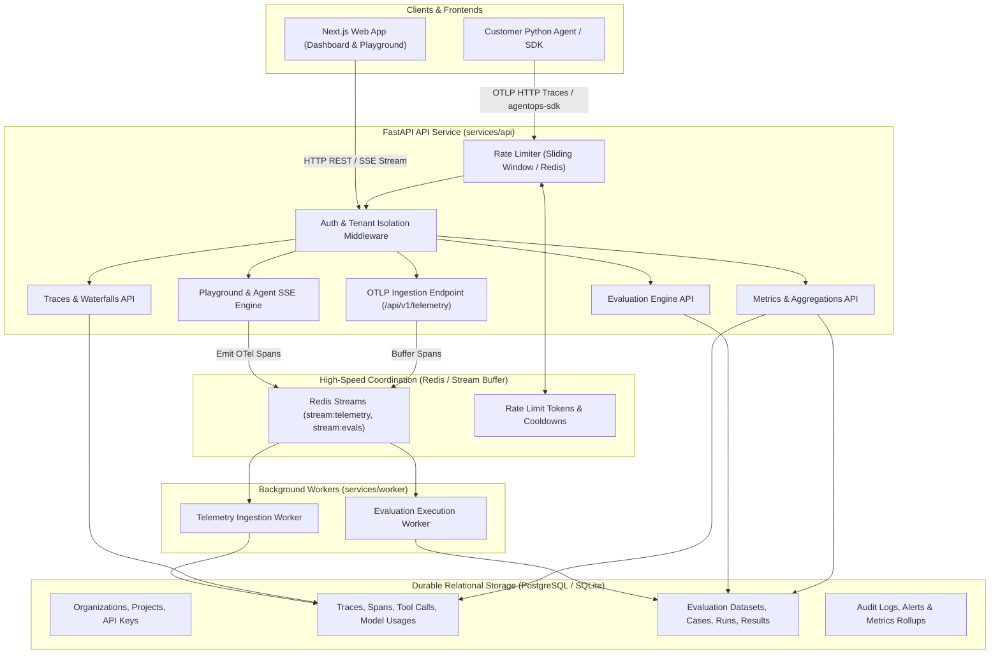

# AgentOps System Architecture & Engineering Blueprint

## Overview
AgentOps provides a unified, production-ready observability and evaluation platform for AI agents.

## Data Ingestion & Execution Flow
1. **Interactive Agent Execution (Playground)**:
   - User submits prompt via web client to `/api/v1/agent-runs`.
   - API initiates stateful execution loop with cancellation tokens.
   - Real-time Server-Sent Events (SSE) stream back: `agent_started`, `step_started`, `tool_executing`, `tool_result`, `agent_completed`.
   - Every execution emits a root Trace and child Spans (Agent Step -> Model Call -> Tool Execution).
2. **Telemetry Ingestion (SDK / OTLP)**:
   - Python SDK batches spans and sends to `/api/v1/telemetry/v1/traces`.
   - Ingestion validates project API key, applies sliding-window rate limit, and flushes to stream buffer.
   - Background worker processes batches and commits to relational database.
3. **Evaluation Engine**:
   - Automated evaluators score agent outputs across: Exact Match, JSON Validity, Tool Call Correctness, Schema Compliance, Latency Threshold, and LLM-as-Judge.
   - Versioned datasets ensure reproducible regression scores over time.
