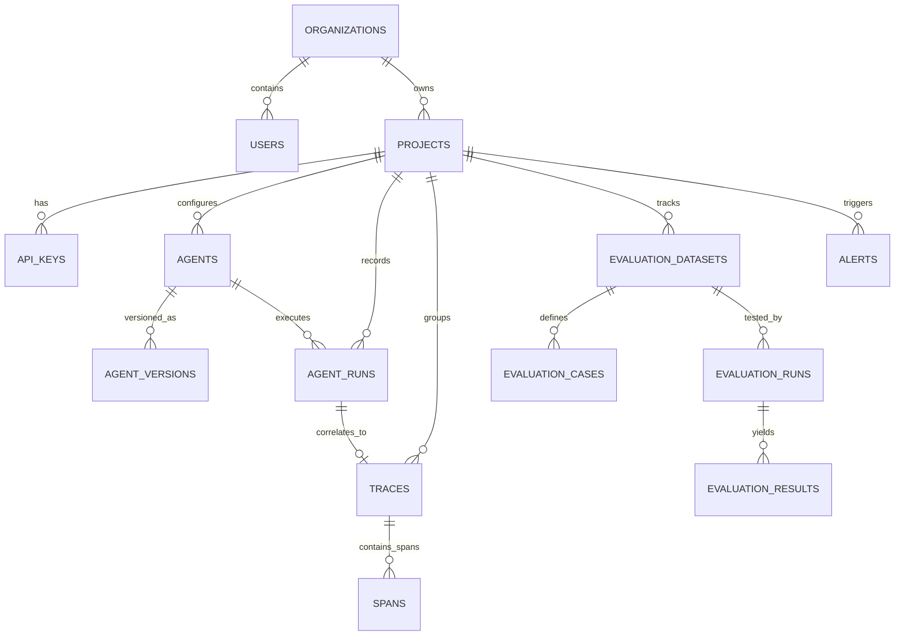

# AgentOps Database Schema & Relational Specifications

Database: PostgreSQL (with async SQLAlchemy 2.0 and asyncpg, fallback SQLite with aiosqlite).

## Relational Entity Model

## Primary Entities

### 1. Organizations & Projects
- `organizations`: Root tenant entity (`id`, `name`, `slug`, `created_at`).
- `projects`: Workspace environments with scoped permissions (`id`, `organization_id`, `name`, `slug`).
- `api_keys`: SHA-256 hashed keys for SDK ingestion (`id`, `project_id`, `key_prefix`, `hashed_key`, `is_active`).

### 2. Traces & Spans (OpenTelemetry Aligned)
- `traces`: Grouping record for an execution waterfall (`id`, `project_id`, `name`, `duration_ms`, `total_tokens`, `is_synthetic`).
- `spans`: Hierarchical OpenTelemetry spans (`span_id`, `trace_id`, `parent_span_id`, `operation_name`, `gen_ai_model`, `prompt_tokens`, `completion_tokens`, `tool_name`).
- Compound Index: `ix_spans_trace_span (trace_id, span_id)`.

### 3. Agent Runs & Playground
- `agent_runs`: Captures prompt, status (`running`, `completed`, `failed`, `cancelled`), final output, total steps, and cost.

### 4. Evaluations & Ground Truth
- `evaluation_datasets`: Golden benchmark test sets.
- `evaluation_cases`: Concrete assertions (`expected_output`, `required_keywords`, `expected_tools`, `json_schema`, `max_latency_ms`).
- `evaluation_runs`: Execution runs comparing agents against datasets.
- `evaluation_results`: Per-case score breakdown and diagnostic reasons.
